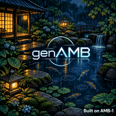
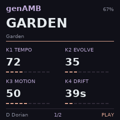

# genAMB FM-1 — DUSK Monumatic Reverb TEST2

Custom firmware for the FM-1. Version **17.99.31** combines DUSK TEST4’s two generative pads, independent pad filters and four-channel mixer with the stereo reverb from Knobula Monumatic. The firmware identifies itself as `FM-1_7179931`.

| Loading screen | HOME · Garden |
| --- | --- |
|  |  |

Both images show the native 240 × 240 display. The loading screen uses the firmware’s indexed RGB565 artwork. HOME is a framebuffer capture from this build’s UI running with the default project.

**[Download TEST2 firmware](https://github.com/Kayman18/FM1-genAMB/raw/refs/heads/main/genAMB-DUSK-Monumatic-Reverb-TEST2.fwsc)** · [Browse source](source/) · [Download source ZIP](https://github.com/Kayman18/FM1-genAMB/archive/refs/heads/main.zip) · [USB web editor](genAMB-DUSK-Monumatic-Reverb-TEST2-Web-Editor.zip) · [Checksums](SHA256SUMS.txt)

It may start in PIANO mode (this mode will let you play Rings or the FM synth Via the Keybed. Depending on Which one you have selected), only the Pad synths will run. Turn the Algorithm knob to place it in scale mode and have the sequencers trigger notes.

*  2 Pad Synths (Both have different Characters Pad 1 - Vintage and Rhodes. Pad 2 - Strings and Glass. Pad 1 has a Chorus Effect, Pad 2 has a Stereo Width setting (cpu maxing out)
*  Rings port - 4 Voice and Modes Kept - Modal, Sympathetic strings, and Strings the rest had to go for space and memory and weren't distinct enough to keep
*  6Voice FM synth, with 16 Presets - Koto, Harp, Brt Harp, Drop, Mallet, Bell, Rin, Bamboo, Furin, Marimba, Celeste, Kalimba, Xylophone, Glockenspiel, Warm Bass, Reso Bass.
*  3 Ported Sequencers from VCVrack: Hallucigenia, Proteus, UNIT-D
*  Burst Setting, to simulate Chords strums
*  Delay on Rings (too costly to add everywhere, may try to add it to FM later)
*  Four-channel mixer. K1 controls Pad 1, K2 Pad 2, K3 Rings and K4 FM.
*  Monumatic stereo reverb at 44.1 kHz. On the FX page, K1 controls Decay, K2 Tone, K3 Motion and K4 Dry/Wet. Turn Dry/Wet to 100 for wet-only output.

## Build and validation

From `source/`, run `sh build-test.sh` for the device or `sh build-test.sh --host` for the desktop simulator. The device build uses the JieLi PI32v2 Linux toolchain (20260730.1). Set `JIELI_TOOLCHAIN` to its extracted directory. The matching SDK boot assets and DUSK fonts are in `source/build-deps/`.

The target rebuild matched the published firmware byte for byte. The firmware package checks and host reverb tests passed. Worst-case CPU, dropouts and listening with both pad filters active still need a run on the FM-1. [Build notes and test results](source/MONUMATIC-TEST2-NOTES.md)

## Attribution and licensing

Built on Charles Vestal's [fm1-amb](https://github.com/charlesvestal/fm1-amb) and [fm1-base](https://github.com/charlesvestal/fm1-base), with [felucca-bsp](https://github.com/hugelton/felucca-bsp) by Leo Kuroshita / Hügelton Instruments. Synthesis components include Mutable Instruments Rings/stmlib by Emilie Gillet and the [Zen-1](https://github.com/aceyprime/zen-1) six-operator FM engine and its msfa-derived core.

### Sequencers

- **Original** — original AMB-1 generative sequencing by [Charles Vestal](https://github.com/charlesvestal/fm1-amb), retained and extended for genAMB (MPL-2.0 provenance).
- **Hallucigenia / Darwinism** — ported from [Eater of Sheep's Extratone / XTRTN source](https://github.com/EaterOfSheep/Extratone/blob/main/src/Darwinism.cpp), GPL-3.0-or-later. RC2 replaces the independent Evolve implementation with this upstream-derived core.
- **Proteus** — adapted from [Seaside Modular Proteus](https://github.com/abluenautilus/SeasideModularVCV/blob/master/src/Proteus.cpp), by Seaside Modular contributors (MIT).
- **UNIT-D / UnitDistanceSeq** — adapted from [Animatek's UNIT-D](https://github.com/animatek/UZZ-VCV-RACK/blob/main/src/UnitDistanceSeq.cpp); the adaptation is GPL-3.0-or-later.

Original copyright and component license notices are retained in the complete source archive. See [LICENSING.md](source/LICENSING.md) for component provenance and combined-firmware licensing.
