# genAMB Nature 1.1 for FM-1

Build an ambient piece from two evolving pads, a Rings resonator, a virtual analog synth and a layer of rain, river and animal calls. A stereo mixer feeds the layers into the Lush reverb.

256 Buffers - This may peak and clip every now and then depending on what you enable, but live playing with no lag in Piano Scale mode is possible on this with lower latency.
512 Buffers - I would use this for the pure generative non playing, More headroom, shouldn't peak of clip, but lower latency if you want to play live.

## Changes in 1.1

- Settings pages use four brushed-aluminum knobs, larger labels and values, and a half-height top info bar.
- The LFO page shows a waveform and four controls. Turn **SELECT** to choose one of six assignable slots. **K1** selects the shape (including Sloth), **K2** the destination, **K3** the depth and **K4** the speed. Fixed pad modulation continues in the background.
- Triple Sloths added as a Modulation Source.
- The VA output is 6 dB louder. Rain falls silent when the sequencer stops, including on MIDI Stop.
- SAVE recognizes flash ID `B36014` for project storage and gives more specific feedback when a write fails. Save and recall passed in simulation. Persistence on this chip still needs a hardware power-cycle check.

## Install

[Download the 1.1 web editor ZIP](https://raw.githubusercontent.com/Kayman18/FM1-genAMB/main/genAMB-Nature-1.1-Web-Editor.zip). Extract it, then launch `start-editor.bat` on Windows or `./start-editor.sh` on Linux or macOS.

Download the firmware from [Releases · genAMB Nature 1.1](https://github.com/Kayman18/FM1-genAMB/releases/tag/v1.1). Both buffer sizes contain the same instruments, patches and editor support.

| Buffer | Normal firmware update | Full M-Flasher image |
|---|---|---|
| 512 samples · more CPU headroom | [512 FWSC](firmware/genAMB-Nature-1.1-512.fwsc) | [512 BIN](firmware/genAMB-Nature-1.1-512-M-Flasher.bin) |
| 256 samples · lower latency | [256 FWSC](firmware/genAMB-Nature-1.1-256.fwsc) | [256 BIN](firmware/genAMB-Nature-1.1-256-M-Flasher.bin) |

Use the FWSC package with the FM-1 firmware updater. For a clean install with M-Flasher, back up the device first. Each BIN writes the full 1 MiB flash, including the settings and calibration region from the clean-install reference. The device updater IDs are 17.99.56 (256) and 17.99.57 (512).

The release packages use the TEST14 firmware bytes. The on-device build label is T14-256 or T14-512.

## Playing a piece

| Layer or control | What it does |
|---|---|
| Pad 1 and Pad 2 | Layer two independently voiced pads. Set their colour and filters, then add slow movement with the LFOs. |
| Rings | Choose Modal, Sympathetic or String for struck and resonating tones. |
| Virtual analog | Blend saw, pulse and triangle colours with a sub oscillator. Shape the sound with pulse width, a resonant filter and separate amp and filter ADSRs. Choose Slow Canopy or one of 20 plucks and 20 basses. For dense pieces, start with two VA voices. |
| Modulation | Route M7–M9 and M12–M14 to destinations including the VA filter. |
| Sequencing | Choose Original, Hallucigenia, Proteus or UNIT-D for the sequenced layers. Use Piano mode to play manually or send MIDI on channel 3 to the VA. |
| Nature | Blend river and rain with a selection of ten animal calls. |
| Mixer and reverb | Balance the layers and adjust their sends to the shared stereo reverb. |
| Piece memory | Store and recall pieces in eight slots with SAVE. |

Use **SEL** to step through the VA main, filter, amp envelope, filter envelope, motion and sequence pages. **GLO** cycles through Mixer, Nature, Setup and the performance display. The [offline web editor](source/web-editor/) provides computer editing through Web MIDI. Open index.html in Chrome or Edge and allow SysEx access.

## On-screen controls

These are native 240 × 240 framebuffer captures from the 1.1 firmware running in its desktop simulator.

| Garden | VA preset browser | VA filter |
|---|---|---|
| 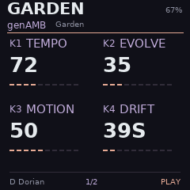 | 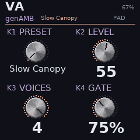 | 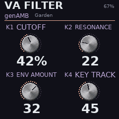 |

### LFO page

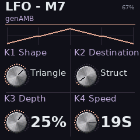

| Nature mixer | Rings |
|---|---|
| 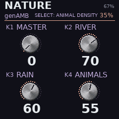 | 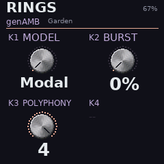 |

### Pad pages

Press **ENV** for Pad 1 or **ARP** for Pad 2. Press the same button again to cycle through Body, Filter and Sequence.

| Pad 1 | Pad 1 body | Pad 1 filter |
|---|---|---|
| 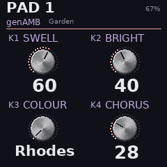 | 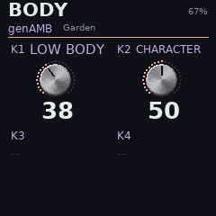 | 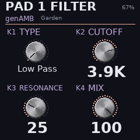 |

| Pad 2 | Pad 2 body | Pad 2 filter |
|---|---|---|
| 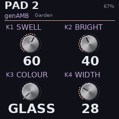 |  | 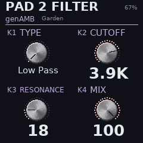 |

### Sequencer pages

Both pad sequencers have octave, octave drift and change controls. Cycle **SEQ** to reach Rings Seq or **SEL** to reach VA Seq. On either page, **ALGO** selects the sequencer mode.

| Pad 1 sequence | Pad 2 sequence |
|---|---|
| 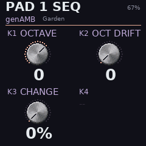 |  |

| Rings sequence | VA sequence |
|---|---|
| 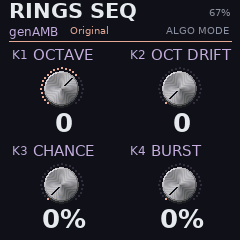 | 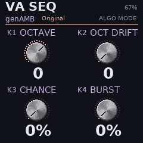 |

| Hallucigenia pattern | Proteus options | UNIT-D options |
|---|---|---|
| 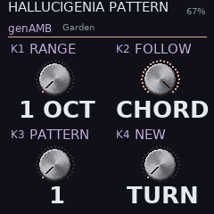 | 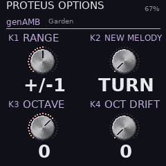 | 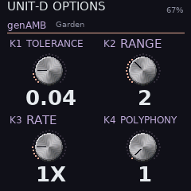 |

## Source and verification

Browse the [firmware source](source/), [DSP](source/app/dsp/), [build instructions](source/BUILDING-RC.md) and [M-Flasher packer](source/tools/make_nature_mflasher.py). Both firmware variants were built and their packaged payloads checked. The host tests cover the VA bank, routing, sequencers, MIDI, keys and save/recall. Physical FM-1 flashing and timing of the 1.1 images remain unverified.

## Credits

Based on Charles Vestal’s fm1-amb and fm1-base, with felucca-bsp by Leo Kuroshita / Hügelton Instruments and Rings/stmlib by Emilie Gillet. Sequencer credits include Charles Vestal (Original), Eater of Sheep (Hallucigenia/Darwinism), Seaside Modular (Proteus) and Animatek (UNIT-D). See [component credits and licensing](source/LICENSING.md).

